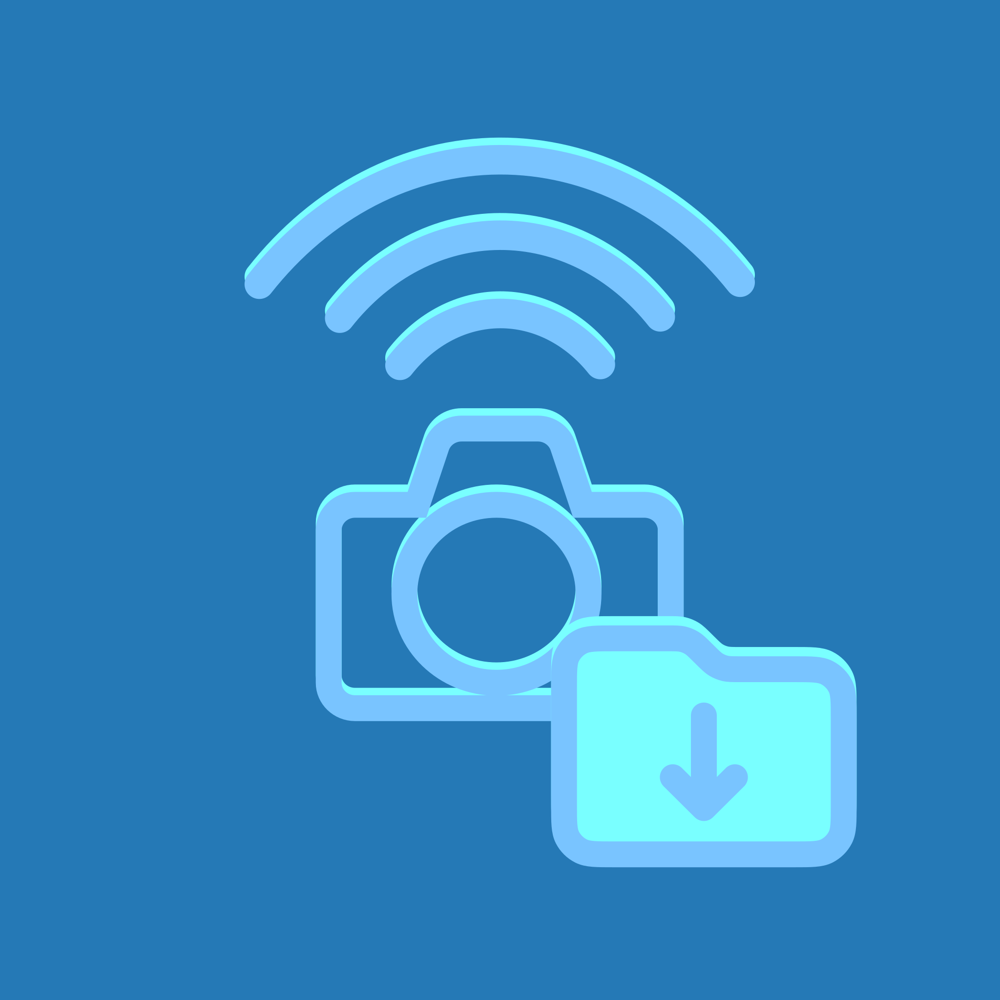
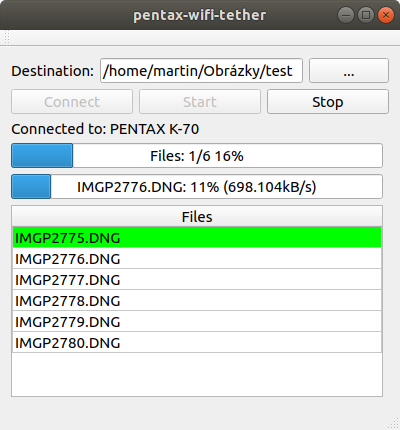
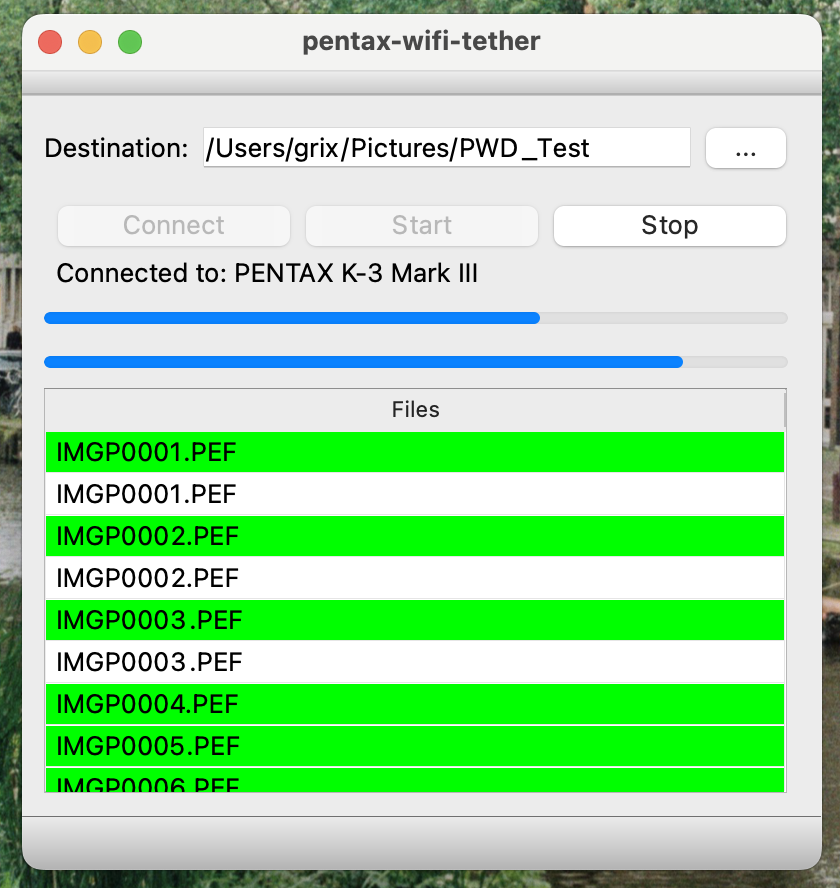

# Pentax-WiFi-Tether

Download your photos from your WiFi-capable Pentax Camera.  

## On Linux

  

## On MacOS

  

## Qtcreator Build Instructions [Original instructions]

Download the opensource edition of Qt5 here https://www.qt.io/download and install Qt5.12.2 or newer and Qtcreator.

    Open `tether.pro` file in Qtcreator and build

## Console Build Instructions [Tested on Ubuntu 20.04]

    1) Install Qt package dependencies:
           sudo apt-get install qt5-default qt5-qmake libqt5multimedia5-plugins qtmultimedia5-dev
    
    2) Clone the repo:
          git clone https://github.com/maruncz/pentax-wifi-tether.git (original)
          or
          git clone https://github.com/g-rix/pentax-wifi-tether.git (this)
       
    3) Change to that directory:
          cd pentax-wifi-tether
    
    4) Configure the project:
          qmake tether.pro CONFIG+=release
    
    5) Build:
         make -j 2
         
    6) Run:
        ./tether

         Ubuntu build-essentials is also needed.

## Usage Instructions

  1) Connect your laptop/PC's WiFi to the camera's WiFi-AP. (See the camera's menus for WiFi credentials.)
  2) Start the 'tether' application and configure the required destination folder.
  3) Press the 'Connect' button, the connected camera will be confirmed.
  4) Press 'Start' to commence the download. The camera's SD-card will be scanned and the filenames will appear on the 'Files' list.
  5) The file download progress will be displayed as they are downloaded.
  6) Press 'Stop' once the download has completed.
  
(The files will automatically be placed into date-sorted folder(s).)

## Supported Pentax Cameras

  1) K70
  2) K3 III

## Notes

  Tested on:
  * Linux laptop [Ubuntu 20.04] and a Pentax K3 III.
  * Macbook Pro M3 [Sonoma: 14.8.9] and a Pentax K3 III.
  * iMac Intel 2020 [Sonoma: 14.8.9] and a Pentax K3 III.
  
 
  May also work with the Pentax KS-2, KP, K1 and K1 II.
